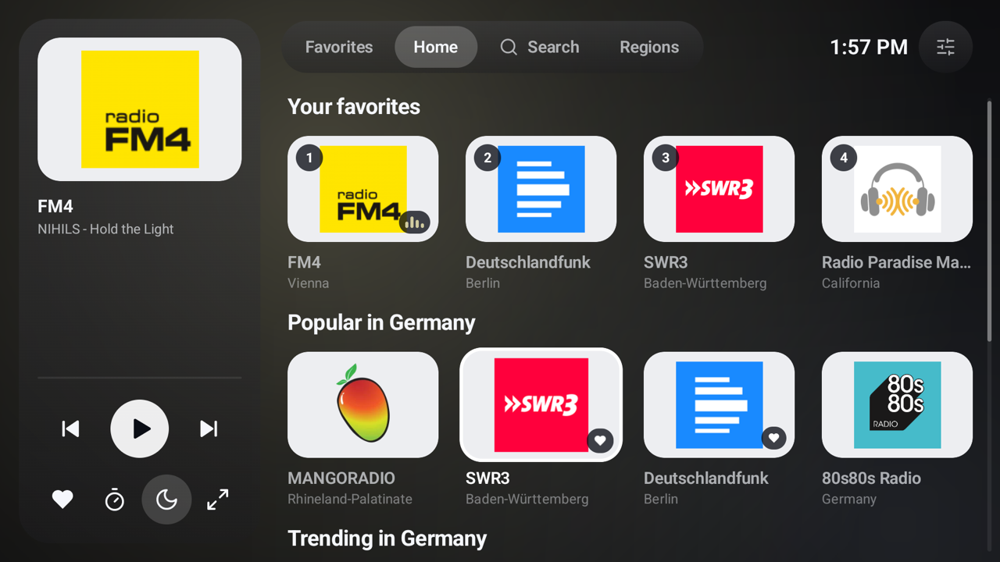
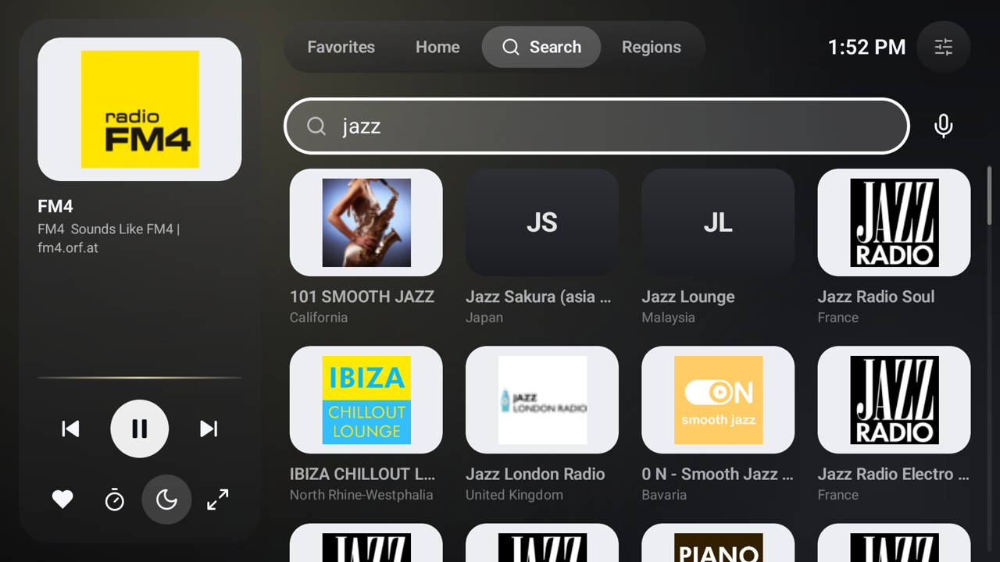
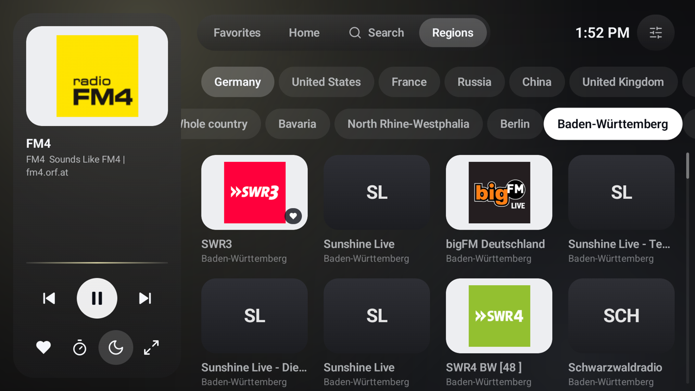
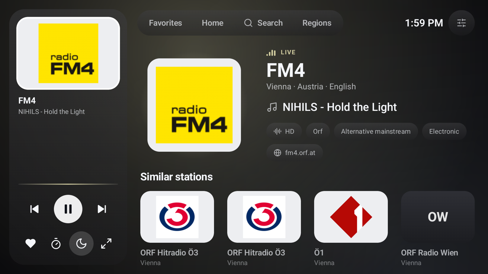
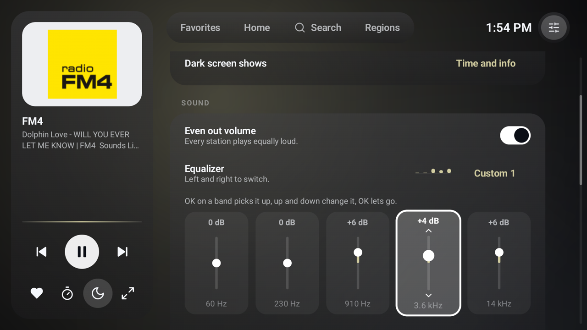
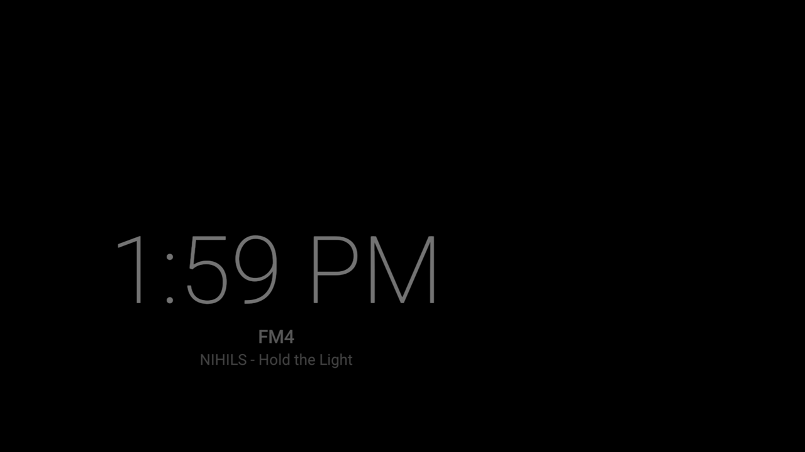

# CannyTVRadio

Calm, ad-free internet radio for Android TV and Google TV.


- **Made for the remote.** Favorites are numbered presets, and the player is always one press away.
- **Keeps playing.** Every station has backup streams. If one fails, the next one starts by itself.
- **Quiet by design.** No ads, no accounts, no tracking. The screen goes dark while you listen.

## Screens

| | |
|---|---|
|  |  |
| **Home.** Popular and trending stations near you. | **Search.** About 50,000 stations, by name, city or genre. |
|  |  |
| **Regions.** Every country, and the states of Germany, Austria and Switzerland. | **Now playing.** The song, the station and similar stations. |
|  |  |
| **Sound.** Even volume, 12 presets and 3 custom profiles. | **Dark screen.** A slowly gliding clock, safe for OLED and Mini-LED. |

## Features

- Stations from [radio-browser.info](https://www.radio-browser.info), with TuneIn as a backup source
- Number keys 1–9 play your favorites; hold OK on one to move it
- Even out volume across stations, plus an equalizer you can tune by ear
- Sleep timer with a soft fade-out
- Works with the remote, a keyboard, a mouse or touch
- German and English

## Install

One APK for every device: Android 5.0 or newer, any processor (ARM or x86). That covers Android TV and Google TV, Fire TV, TV boxes, tablets, phones and Chromebooks.

The app isn't in the Play Store. Build it and install it with adb (JDK 17 and the Android SDK needed):

```bash
./gradlew assembleRelease
```

```bash
adb connect <tv-ip>:5555
```

```bash
adb install -r app/build/outputs/apk/release/app-release.apk
```

To turn on network debugging, enable the developer options on the TV.

## Under the hood

Kotlin, Jetpack Compose, Media3 and Coil, in one small app. It's tuned for slow TV chips: idle screens draw nothing, large surfaces are cached, and logos load once the remote pauses. Every change was measured on a real TV.

## Credits

Station data from [radio-browser.info](https://www.radio-browser.info) and TuneIn. Icons adapted from [Lucide](https://lucide.dev) (ISC).
