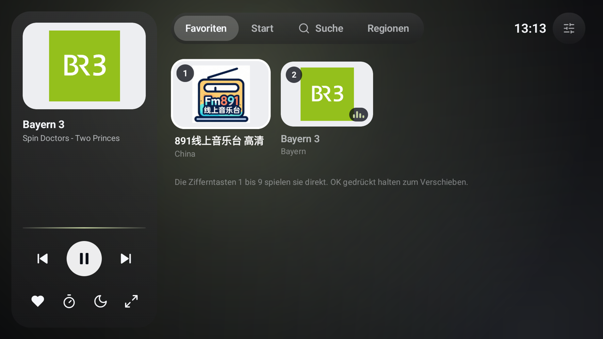

# CannyTVRadio

A calm, ad-free internet radio app for Android TV and Google TV. Built for the remote control, tuned for slow TV hardware, and made to keep playing when a stream fails.



## Features

**Listening**
- About 50,000 stations from [radio-browser.info](https://www.radio-browser.info), with TuneIn's public directory as a second source.
- Every station carries several streams. When one fails or stalls, the next one starts by itself; when all fail, fresh streams are fetched and tried again, and playback resumes when the network comes back.
- Favorites keep their working streams and backups on the device, so they still play when the directory is offline.
- Smart buffering for live radio: playback starts after 1.5 s, then builds a cushion of up to 60 s.
- Keeps playing in the background, with media keys and Google TV's controls.

**Finding stations**
- Favorites first, numbered like radio presets (number keys 1 to 9 play them).
- Search across both directories at once, ranked by name match and popularity. "oe3" finds "Ö3".
- Regions: Germany, Austria and Switzerland are mapped to their official states and cantons, whatever spelling the directory uses ("Bavaria", "Bayern" and "Bayern, München, AAC 128" are one region), and shown in the app's language.
- Popular, trending and recently played stations on the start page.

**Sound**
- Volume leveling, so every station plays equally loud.
- A 5-band equalizer with 12 presets (Neutral, Bass, Club, Voice, Pop, Rock, Jazz, Classical, Warm, Bright, Loudness, Night) and three custom profiles: pick up a band with OK, set it with up and down, and hear the change right away.
- Both run inside the app's own audio pipeline, so they sound the same on every TV.

**Screen**
- Goes dark after a chosen time while music plays (toggle with the moon in the player).
- Made for OLED and Mini-LED: black screen, lowest backlight, and a clock that glides slowly and smoothly on a path that never repeats, so nothing burns in.
- Sleep timer that fades out over the last 30 seconds.

**Remote control**
- The player is always one press away: Back jumps to Play from anywhere.
- Hold OK on a favorite to move it with the arrows; hold OK again to remove it.
- Channel up and down switch between favorites.

German and English, following the TV's language or set in the app. No ads, no accounts, no tracking: the app only talks to the station directories and to the stations' own stream servers.

## Install

The app is not in the Play Store. Build it and install it over the network with adb.

Requirements: JDK 17 and the Android SDK (platform 35).

```bash
./gradlew assembleRelease
```

On the TV, turn on developer options and network debugging, then:

```bash
adb connect <tv-ip>:5555
```

```bash
adb install -r app/build/outputs/apk/release/app-release.apk
```

Precompiling the app once after installing makes it start and scroll faster:

```bash
adb shell cmd package compile -m speed -f com.cannytvradio
```

The release build is signed with the local debug key, which is fine for sideloading.

## How it is built

Kotlin, Jetpack Compose, Media3 (ExoPlayer), OkHttp and Coil. One activity, one process.

| Package | What it does |
|---|---|
| `data` | Station directories with fallback (`RadioBrowser`, `TuneIn`), favorites and history (`Repository`), the browse state that survives tab switches (`BrowseModel`), region names (`Regions`), settings |
| `player` | The player with stream fallback, stall detection and reconnect (`PlayerController`), the background media session (`PlaybackService`), equalizer and leveling (`SoundProcessor`) |
| `ui` | Shared building blocks (`Components`, `Theme`, `Icons`) and the screens |

Region mapping is covered by unit tests (`./gradlew testReleaseUnitTest`).

## Performance on TV hardware

TV chips draw interfaces slowly; on the reference TV even the built-in home screen runs at a median of 36 ms per frame. The app is shaped around that, and every change was measured with `dumpsys gfxinfo` and system traces on the real TV:

- **Nothing moves, nothing is drawn.** Idle screens render zero frames; the only always-running animation (the background while music plays) is stepped, and pauses while keys are pressed.
- **Big surfaces are cached.** The background, the player column, the tab bar, every logo and every settings group are rendered once into their own layer; scrolling moves finished images. This cut per-frame drawing work by half and fill operations by over 80 %.
- **Tiles are cheap to build.** Logos load only once the remote pauses, rows are built ahead with Compose's cache window, country names and initials are computed once.
- **Held arrow keys don't pile up.** One step every 110 ms, extra repeats are dropped, and steps jump instead of animating.
- **Calm scrolling.** Lists only scroll when the focused tile would leave the screen, and rows always show whole tiles.

## Credits

- Station data: [radio-browser.info](https://www.radio-browser.info) (community directory) and TuneIn's public OPML directory.
- Icons: path data adapted from [Lucide](https://lucide.dev) (ISC license).
