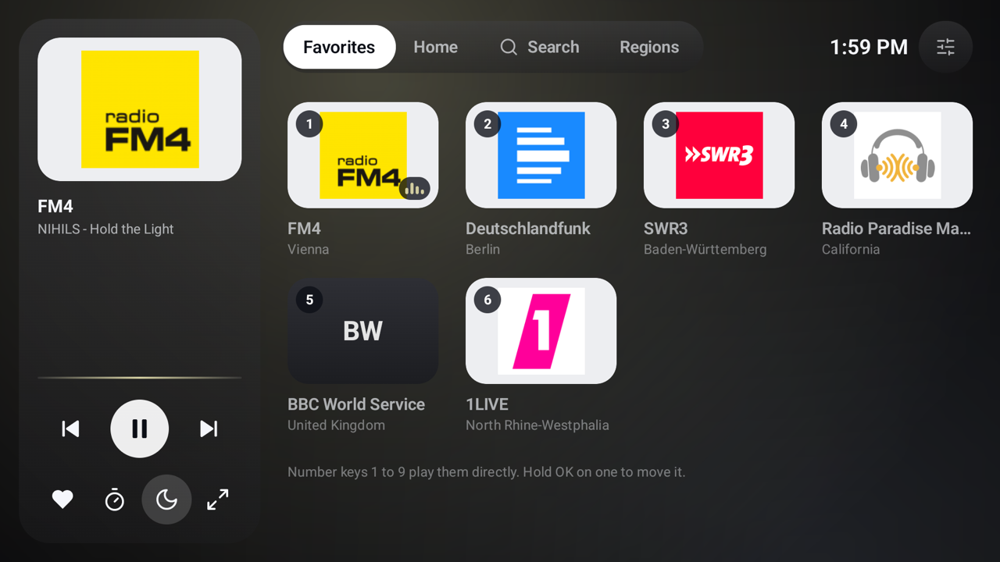

# CannyTVRadio: internet radio for Android TV

A free, ad-free internet radio app for Android TV, Google TV and Fire TV. About 50,000 stations, made for the remote.



- **Made for the remote.** Favorites are numbered presets, and the player is always one press away.
- **Keeps playing.** Every station has backup streams. If one fails, the next one starts by itself.
- **Quiet by design.** No ads, no accounts, no tracking. The screen goes dark while you listen.

## Download

On your TV, open the **Downloader** app and enter:

```
https://github.com/davbauer/CannyTVRadio/releases/latest/download/CannyTVRadio.apk
```

Install the downloaded file and you're done. This address always gives the newest version, and the app also offers updates by itself under **Settings → Updates**.

One APK for every device with Android 5.0 or newer: Android TV, Google TV, Fire TV, TV boxes, tablets, phones and Chromebooks, on ARM and x86. All versions are on the [releases page](https://github.com/davbauer/CannyTVRadio/releases).

## Screens

| | |
|---|---|
|  |  |
| **Home.** Popular and trending stations near you. | **Search.** About 50,000 stations, by name, city or genre. |
|  |  |
| **Regions.** Every country, and the states of Germany, Austria and Switzerland. | **Now playing.** The song, the station and similar stations. |
|  |  |
| **Sound.** Even volume, 12 presets and 3 custom profiles. | **Dark screen.** A slowly gliding clock, safe for OLED and Mini-LED. |

## Features

- Stations from [radio-browser.info](https://www.radio-browser.info), with TuneIn as a backup source
- Number keys 1–9 play your favorites; hold OK on one to move it
- Even out volume across stations, plus an equalizer you can tune by ear
- Sleep timer with a soft fade-out
- Works with the remote, a keyboard, a mouse or touch
- German and English

## Build it yourself

You need JDK 17 and the Android SDK.

```bash
./gradlew assembleRelease
```

```bash
adb install -r app/build/outputs/apk/release/app-release.apk
```

Releases are signed with the project's own key, and the app only installs updates signed with that key. A build of your own is signed with your debug key, so uninstall the release version first.

## Under the hood

Kotlin, Jetpack Compose, Media3 (ExoPlayer) and Coil, in one small app. It's tuned for slow TV chips: idle screens draw nothing, large surfaces are cached, and logos load once the remote pauses. Every change was measured on a real TV.

## Credits

Station data from [radio-browser.info](https://www.radio-browser.info) and TuneIn. Icons adapted from [Lucide](https://lucide.dev) (ISC).
